# ARMI 8-frame world rebuild review

2026-10-05 · feat-immersive-portfolio-flow · 커밋/푸시/병합/배포 없음

## 범위와 사실

기존 로컬 변경과 untracked 파일은 보존했다. ENTRY→TABLET→PORTAL 경로·원본 영상·aperture interaction을 유지하고 post-portal 세계를 재구성했다.

Golden Route는 **Text Answer**다. 저장소의 LangGraph StateGraph 분기와 원본 제품의 대화 모드에 맞는 설명용 경로다. 원본 영상이 이 특정 요청의 내부 실행을 증명한다는 주장은 하지 않는다.

근거: src/data/armiCaseStudy.ts, src/data/projectDetails.ts, src/components/project/armi/ArmiProductScreens.tsx, public/videos/Patient Tablet App.mp4. Google Cloud STT, Qwen 30B·LangGraph, Text Answer/Robot Action/Tavily Search/Memory Retrieval와 Redis 원문·Chroma 의미 검색은 저장소 근거가 있다. 가상의 의료 답변·수치·UI는 추가하지 않았다.

reference의 정보 패널·archive cell·robot arm·service rail·shaft·모든 공간 치수는 설명용 architectural metaphor다. 실제 ARMI 서버·하드웨어·데이터베이스 내부 형상을 재현하지 않는다.

## 교체와 world kit

이전의 소수 목적지 패널과 단순 route line을 다층 column/flange/crossbeam/platform/service bay, 지지형 twin rail, ordered response terrace, horizontal search array, stacked memory cells, articulated action bay로 교체했다. 기존 한 Canvas·한 camera·progress ref·동일 request entity와 역스크롤 구조를 재사용한다. ArchitectureBatch는 구조와 발광 요소를 기본 세계 2개와 제품 복귀 corridor 2개의 InstancedMesh로 묶고 instance transform은 생성 시 한 번 기록한다.

Three.js 기존 addons의 제한적인 bloom, OutputPass, 기존 Drei reflector와 fog를 사용했다. 새 dependency는 없다. 카메라/신호/시선 경로는 별도 curve이며 프레임마다 React state를 업데이트하지 않는다. 모바일에서는 geometry 수와 reflection resolution을 낮추고 x/y 압축·FOV·거리 보정으로 별도 구도를 제공한다. 실제 저사양 기기 FPS는 측정하지 않았다.

## 시각 검토 경과

첫 실제 렌더에서는 전경 기둥이 목적지와 Result를 가렸다. 중앙 시야를 열고 기둥을 외곽으로 옮겼다. Result 뒤의 response terrace를 더 깊게 이동했다. district light hotspot을 낮추고 cyan shaft를 강화했다. 두 번째 검토에서 STT 배경과 Result 응답의 경쟁이 보여 배경 밝기와 신호 위계를 추가 조정했다.

같은 cinematic quality class를 달성했다고 주장하지 않는다. 현재 결과의 장점은 하나의 세계에서 경로를 발견하고 따라간 뒤 원본 제품으로 돌아오는 연속성이다. reference 대비 물리적인 재질, 비반복 미세 모델링, 볼륨 조명, 광학적 깊이는 남은 작업이다.

## Camera / composition

좌표는 WebGL 설명 공간의 내부 단위이며 실제 길이·장치 치수가 아니다. yaw/pitch/roll은 Three.js Euler XYZ 기준, 표는 pointer offset/bank를 제외한 경로 기준값이다. 실제 Travel의 bank는 최대 약 2°이며 모바일에는 없다. 점유율은 렌더 화면의 육안 추정/목표이고 픽셀 segmentation 측정값이 아니다. camera spec 전체 데이터는 docs/qa/world-camera-spec.json에 보관한다.

### 01 entry

- CAMERA: position [0,0.6,12], height 0.6, lookAt [1.6,0.25,0], distance 12.11, yaw/pitch/roll [-7.59,-1.67,-0.22]°, FOV 43°.
- SCALE / SUBJECT: actual Tablet; dominant target 55%. 태블릿 외곽·기둥 약 10–15%.
- FOREGROUND: 태블릿 외곽·기둥 약 10–15%.
- MIDGROUND: 원본 Patient Tablet App UI.
- BACKGROUND / DENSITY: 기존 ENTRY의 건축 프레임과 바닥; low.
- VANISHING POINT: 태블릿 중심 오른쪽.
- LIGHT / COLOR: 원본 화면 자체의 warm-white가 가장 밝음. lime=request/selected operation, cyan=depth/input infrastructure, warm=product/response/context.
- NEGATIVE SPACE: 하단 narrative 영역은 어두운 gradient로 가독성 확보; 중앙 action 구역에 시선 집중.
- REQUEST: [-1.15,0.1,-8.4].
- DESTINATION: product surface.
- TEXT-OFF: 제품 표면은 읽히지만 음성 입력 의도는 원본 UI·waveform에 의존. 전체 의미 판정은 실제 04 text-off 캡처와 각 장면의 geometry 검토에 근거하며 모든 frame을 별도 text-off 캡처한 것은 아니다.
- REFERENCE GAP: 실제 UI를 보존했고 레퍼런스의 베젤·재질·반사는 덜 풍부함.

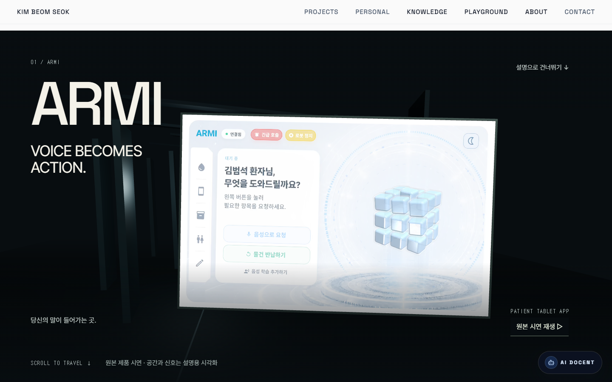

### 02 portal

- CAMERA: position [0.3,-0.4,0.85], height -0.4, lookAt [-0.82,-0.17,-6.62], distance 7.55, yaw/pitch/roll [8.55,1.73,-0.26]°, FOV 43°.
- SCALE / SUBJECT: product aperture; dominant target 80%. 확대된 제품 표면·aperture 약 70–85%.
- FOREGROUND: 확대된 제품 표면·aperture 약 70–85%.
- MIDGROUND: 같은 요청이 열린 제품 표면을 통과.
- BACKGROUND / DENSITY: 기존 내부 프레임; medium.
- VANISHING POINT: 오른쪽 aperture 중심.
- LIGHT / COLOR: 제품 화면과 aperture rim. lime=request/selected operation, cyan=depth/input infrastructure, warm=product/response/context.
- NEGATIVE SPACE: 하단 narrative 영역은 어두운 gradient로 가독성 확보; 중앙 action 구역에 시선 집중.
- REQUEST: [-1.15,0.1,-8.4].
- DESTINATION: transcription layers.
- TEXT-OFF: 화면을 통과하는 공간적 의미는 읽힘. 전체 의미 판정은 실제 04 text-off 캡처와 각 장면의 geometry 검토에 근거하며 모든 frame을 별도 text-off 캡처한 것은 아니다.
- REFERENCE GAP: 레퍼런스의 얇은 cyan rim보다 넓고 lime 기운이 있음. 성공한 기존 interaction 보존.

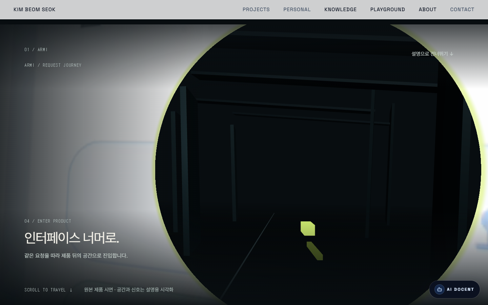

### 03 understand

- CAMERA: position [-3.66,1.76,-7.87], height 1.76, lookAt [2.24,2.63,-17.21], distance 11.09, yaw/pitch/roll [-32.14,5.35,2.85]°, FOV 45.99°.
- SCALE / SUBJECT: six transcription layers; dominant target 48%. 6개 투명 processing plane 약 35–45%.
- FOREGROUND: 6개 투명 processing plane 약 35–45%.
- MIDGROUND: 왼쪽 불규칙 waveform → 레이어 통과 → 오른쪽 lime 정렬.
- BACKGROUND / DENSITY: 밝기를 낮춘 다음 라우팅 공간; medium.
- VANISHING POINT: 우측 레이어 안쪽.
- LIGHT / COLOR: white edge / white 입력, lime 해석 신호. lime=request/selected operation, cyan=depth/input infrastructure, warm=product/response/context.
- NEGATIVE SPACE: 하단 narrative 영역은 어두운 gradient로 가독성 확보; 중앙 action 구역에 시선 집중.
- REQUEST: [5.5,3.1,-19.24].
- DESTINATION: structured request at right.
- TEXT-OFF: 흐트러진 입력이 정돈되는 형태는 읽힘. STT 기술명은 텍스트가 필요. 전체 의미 판정은 실제 04 text-off 캡처와 각 장면의 geometry 검토에 근거하며 모든 frame을 별도 text-off 캡처한 것은 아니다.
- REFERENCE GAP: 레이어의 재질·볼륨 광선과 미세 입자 밀도는 레퍼런스보다 절제됨.

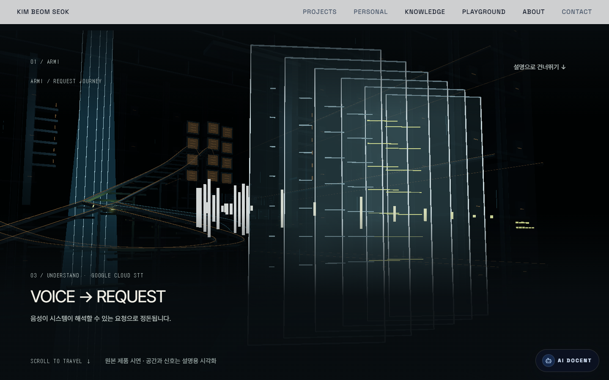

### 04 routing

- CAMERA: position [-0.94,8.44,-24.44], height 8.44, lookAt [0,5.48,-45.95], distance 21.73, yaw/pitch/roll [-2.47,-7.86,-0.34]°, FOV 55.91°.
- SCALE / SUBJECT: small request inside system atrium; dominant target 10%. 교차 service rail·외곽 구조 약 20–25%.
- FOREGROUND: 교차 service rail·외곽 구조 약 20–25%.
- MIDGROUND: 작은 동일 request와 네 district.
- BACKGROUND / DENSITY: 다층 플랫폼·수직 shaft·cross beam·service bay; high.
- VANISHING POINT: 중앙 shaft 아래 junction.
- LIGHT / COLOR: cyan shaft는 깊이, warm은 district, lime은 request만. lime=request/selected operation, cyan=depth/input infrastructure, warm=product/response/context.
- NEGATIVE SPACE: 하단 narrative 영역은 어두운 gradient로 가독성 확보; 중앙 action 구역에 시선 집중.
- REQUEST: [0.14,4.72,-41.9].
- DESTINATION: four distinct districts.
- TEXT-OFF: text-off로 네 실루엣과 분기 교차 공간을 확인. 각각의 기능 이름까지 무문자로 전달되지는 않음. 전체 의미 판정은 실제 04 text-off 캡처와 각 장면의 geometry 검토에 근거하며 모든 frame을 별도 text-off 캡처한 것은 아니다.
- REFERENCE GAP: junction entity는 약 2–3%로 목표 8–15%보다 작음. 재질 반복과 직각 모듈이 여전히 두드러짐.

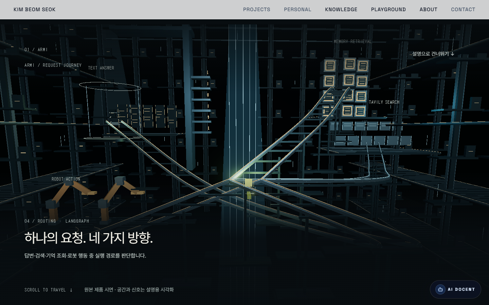

### 05 decision

- CAMERA: position [1.51,7.15,-24.83], height 7.15, lookAt [1.97,4.21,-43.61], distance 19.01, yaw/pitch/roll [-1.4,-8.9,-0.22]°, FOV 50.58°.
- SCALE / SUBJECT: one activated S-shaped service bridge; dominant target 40%. 선택된 S/대각 bridge 약 35–45%.
- FOREGROUND: 선택된 S/대각 bridge 약 35–45%.
- MIDGROUND: 한 경로만 lime로 순차 점등, 나머지는 비활성.
- BACKGROUND / DENSITY: 발견한 네 district와 같은 atrium; high.
- VANISHING POINT: 왼쪽 위 Text Answer.
- LIGHT / COLOR: lime bridge와 junction이 가장 밝음. lime=request/selected operation, cyan=depth/input infrastructure, warm=product/response/context.
- NEGATIVE SPACE: 하단 narrative 영역은 어두운 gradient로 가독성 확보; 중앙 action 구역에 시선 집중.
- REQUEST: [0,5,-44].
- DESTINATION: Text Answer upper left.
- TEXT-OFF: 다중 분기 중 단일 경로의 선택은 읽힘. 전체 의미 판정은 실제 04 text-off 캡처와 각 장면의 geometry 검토에 근거하며 모든 frame을 별도 text-off 캡처한 것은 아니다.
- REFERENCE GAP: 광원이 junction 근처에서 퍼짐. 레퍼런스의 유려한 에너지 유동보다 segmented rail 성격이 강함.

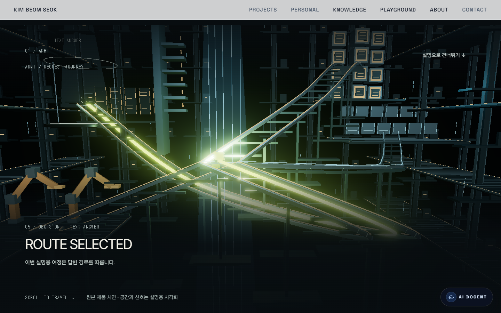

### 06 travel

- CAMERA: position [-0.48,5.91,-50.65], height 5.91, lookAt [-11.91,6.14,-61.55], distance 15.79, yaw/pitch/roll [46.35,1.21,-0.87]°, FOV 48°.
- SCALE / SUBJECT: selected bridge through infrastructure; dominant target 40%. 근접 기둥·rail-side frame 약 25–35%.
- FOREGROUND: 근접 기둥·rail-side frame 약 25–35%.
- MIDGROUND: 카메라보다 앞선 요청과 선택된 지지형 bridge.
- BACKGROUND / DENSITY: Text Answer 플랫폼·response chamber·다층 구조; highest.
- VANISHING POINT: 중앙 위 response chamber.
- LIGHT / COLOR: lime rail은 진행, warm marker는 infrastructure, cyan은 깊이. lime=request/selected operation, cyan=depth/input infrastructure, warm=product/response/context.
- NEGATIVE SPACE: 하단 narrative 영역은 어두운 gradient로 가독성 확보; 중앙 action 구역에 시선 집중.
- REQUEST: [-10.21,4.59,-59.72].
- DESTINATION: response chamber ahead.
- TEXT-OFF: 경로를 따라 목적지에 접근하는 의미는 읽힘. 전체 의미 판정은 실제 04 text-off 캡처와 각 장면의 geometry 검토에 근거하며 모든 frame을 별도 text-off 캡처한 것은 아니다.
- REFERENCE GAP: 이 체크포인트는 rail이 수직에 가깝게 보임. 레퍼런스의 긴 S 원근과 고급 표면 디테일이 부족.

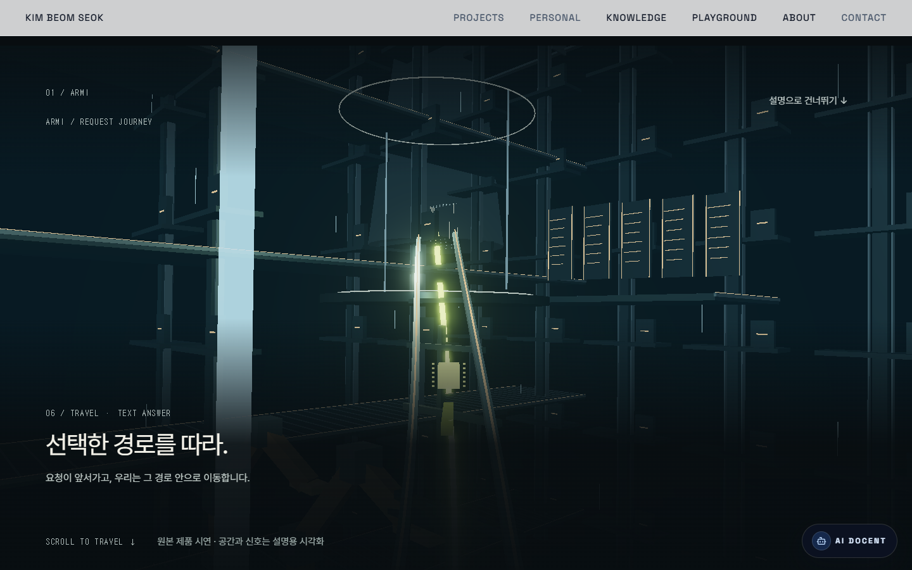

### 07 result

- CAMERA: position [-20.08,10.8,-56.16], height 10.8, lookAt [-20,10,-68], distance 11.86, yaw/pitch/roll [-0.39,-3.87,-0.03]°, FOV 42°.
- SCALE / SUBJECT: aligned response layers; dominant target 35%. 중앙 nested response field 약 30–40%.
- FOREGROUND: 중앙 nested response field 약 30–40%.
- MIDGROUND: 같은 36 signal segments가 6개 정보 행으로 정리.
- BACKGROUND / DENSITY: 밝기를 낮춘 기존 chamber와 후면 response terrace; low.
- VANISHING POINT: 중앙 응답체.
- LIGHT / COLOR: warm-white response bars 우선, lime 잔여 상태, cyan overhead. lime=request/selected operation, cyan=depth/input infrastructure, warm=product/response/context.
- NEGATIVE SPACE: 하단 narrative 영역은 어두운 gradient로 가독성 확보; 중앙 action 구역에 시선 집중.
- REQUEST: [-20,10,-68].
- DESTINATION: same product surface.
- TEXT-OFF: 요청에서 정리된 정보 묶음으로 바뀌는 형태는 읽힘. 실제 답변 내용은 만들지 않음. 전체 의미 판정은 실제 04 text-off 캡처와 각 장면의 geometry 검토에 근거하며 모든 frame을 별도 text-off 캡처한 것은 아니다.
- REFERENCE GAP: 응답체는 설명용 추상 geometry. 레퍼런스의 volumetric 조명·반사·독립적인 hero 완성도에는 차이.

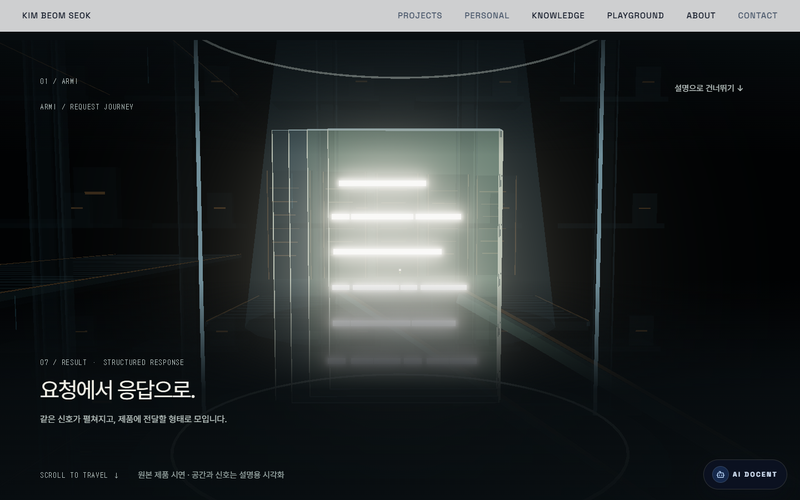

### 08 return

- CAMERA: position [2.4,0.6,12], height 0.6, lookAt [2.4,0,0], distance 12.01, yaw/pitch/roll [0,-2.86,0]°, FOV 43°.
- SCALE / SUBJECT: original conversation mode; dominant target 55%. 원본 태블릿 화면 약 50–60%.
- FOREGROUND: 원본 태블릿 화면 약 50–60%.
- MIDGROUND: 앞서 돌아가는 응답 → 같은 실제 제품 UI.
- BACKGROUND / DENSITY: 기존 ENTRY 공간; low.
- VANISHING POINT: 제품 화면 중심.
- LIGHT / COLOR: 실제 화면의 white/cyan을 원래 render pipeline으로 보존. lime=request/selected operation, cyan=depth/input infrastructure, warm=product/response/context.
- NEGATIVE SPACE: 하단 narrative 영역은 어두운 gradient로 가독성 확보; 중앙 action 구역에 시선 집중.
- REQUEST: [0.3,-0.4,0.1].
- DESTINATION: existing Brief.
- TEXT-OFF: 제품으로 돌아온다는 의미는 읽힘. 실제 영상은 정확한 선택 route의 실행 추적 증거가 아님. 전체 의미 판정은 실제 04 text-off 캡처와 각 장면의 geometry 검토에 근거하며 모든 frame을 별도 text-off 캡처한 것은 아니다.
- REFERENCE GAP: 레퍼런스의 동일 샷과 다른 실제 UI. 가짜 응답이나 새 UI를 만들어 맞추지 않음.

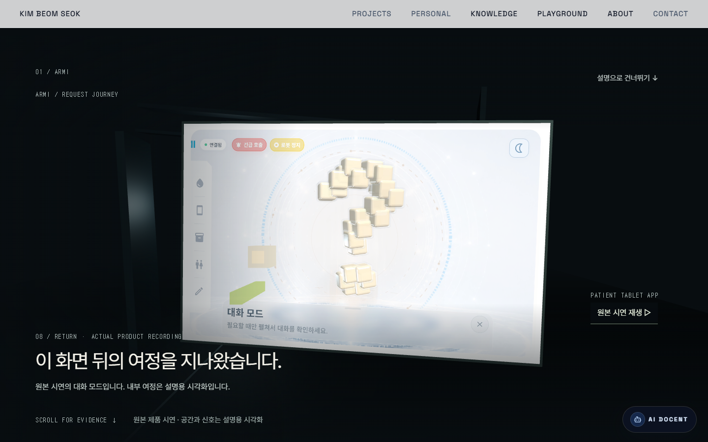

## Routing 특별 검토

카메라는 위 04 표의 중간 높이 entrance view다. request는 junction에서 약 2–3% 크기이며, 중심 chamber 자체는 대형 shaft와 교차 경로로 읽힌다. Text Answer는 왼쪽 상부의 세로 응답 terraces, Tavily Search는 오른쪽 중단의 넓은 수평 array, Memory Retrieval은 오른쪽 상단의 반복 archive cell, Robot Action은 왼쪽 하단의 관절형 실루엣이다. 각 실루엣의 구조 차이는 라벨 없이 확인했다. lime은 중앙 request에 제한하고 Decision 이후 Text Answer 경로 하나만 점등한다. 전경 rail은 약 20–25%다. 텍스트가 없어도 분기 공간이 읽히지만 reference의 압도적인 perceived scale에는 아직 차이가 있다.

## Transition choreography

1. Entry→Portal: 기존 waveform gather·태블릿 접근·aperture 통과 유지.
2. Portal→Understand: 6개 processing layer를 비스듬히 관찰; raw 신호가 정렬 신호로 변화.
3. Understand→Routing: 넓은 FOV로 chamber와 네 구역을 발견.
4. Routing→Decision: 먼저 카메라 이동을 멈춘 뒤 단일 rail을 순차 점등; 이후 낮고 가까운 시점으로 이동.
5. Decision→Travel: 별도의 camera/look/request curve, 곡선 가속과 높이 변화, 근접 frame 두 번 통과.
6. Travel→Result: 선택 rail 점등이 줄고 카메라가 정지; 같은 request segments가 정보 행으로 펼쳐짐.
7. Result→Return: request가 먼저 이동하고 camera가 따라감; 같은 태블릿 표면을 다시 보여줌.
8. Return→Brief: 기존 Brief와 CTA 흐름 유지. 후속 행가래·Wedding·개인 프로젝트 구조는 이번 작업 범위 밖으로 보존.

## 모바일 카메라

| Frame | Camera | LookAt | FOV |
|---|---|---|---|
| entry | [0,0.6,24] | [2.4,0.25,0] | 43° |
| portal | [0.3,-0.4,5.82] | [-0.49,-0.17,-6.62] | 43° |
| understand | [-1.83,1.23,-3.88] | [1.12,1.84,-17.21] | 55.96° |
| routing | [-0.47,5.91,-16.45] | [0,3.83,-45.95] | 67.91° |
| decision | [0.75,5.01,-22.54] | [0.99,2.95,-43.61] | 65.29° |
| travel | [-0.24,4.14,-48.83] | [-5.96,4.3,-61.55] | 57.12° |
| result | [-10.04,7.56,-49.16] | [-10,7,-68] | 52° |
| return | [2.4,0.6,26] | [2.4,-2.1,0] | 43° |

390×844에서 STT/ Routing/ Travel/ Result/ Return을 실제 확인했다. 모바일 Routing은 네 district가 보이지만 작은 디테일은 줄었다. Result는 중앙 응답체가 화면에 들어오며 원본 UI가 모바일 복귀 화면에 들어온다. body scrollWidth가 viewport width를 넘지 않는 것을 확인했다.

## 검증

- npm run build: 통과.
- npm test: 461/461 통과.
- npm run lint: 기존 173 problems (32 errors, 141 warnings), vendor/무관한 파일 수정 없음.
- ARMI journey + 회귀 테스트 범위 eslint: 통과.
- git diff --check: 통과 (기존 LF/CRLF 경고만). staged diff 없음.
- 브라우저 최종 QA: 아래 최종 QA 기록 참조.

8 desktop PNG는 CDP viewport의 실제 scrollY를 clip origin으로 사용해 1440×900 전체 화면을 저장했다. 원래 IAB screenshot API의 native panel clipping 결과는 최종 desktop 증거로 사용하지 않았다. 이미지를 확대하거나 잘린 픽셀을 합성해 full viewport로 주장하지 않았다.

## 이번 재시도 수정 파일

- src/components/sections/ImmersiveProjectFlow/armiJourney/ArchitectureKit.tsx: world-building kit와 instancing, return corridor.
- src/components/sections/ImmersiveProjectFlow/armiJourney/worldConfig.ts: 네 district·route·frame composition.
- src/components/sections/ImmersiveProjectFlow/armiJourney/goldenPaths.ts: world camera/look/request curve와 모바일 프레이밍.
- src/components/sections/ImmersiveProjectFlow/armiJourney/ArmiSystemWorld.tsx: six STT layers·네 구역·selected bridge·response chamber.
- src/components/sections/ImmersiveProjectFlow/armiJourney/ArmiLightTreatment.tsx: 제한적인 bloom과 원본 UI render pipeline 보존.
- src/components/sections/ImmersiveProjectFlow/armiJourney/ArmiCanvas.tsx: 지속되는 세계와 light treatment 연결.
- src/components/sections/ImmersiveProjectFlow/armiJourney/ArmiCameraRig.tsx: far plane·fog range·travel bank.
- src/components/sections/ImmersiveProjectFlow/armiJourney/ArmiVoiceSignal.tsx: 동일 신호의 waveform/정렬/응답 재배열과 밝기.
- src/components/sections/ImmersiveProjectFlow/armiJourney/ArmiStillWorld.tsx: reduced-motion 의미 중심 static geometry.
- tests/armi-journey.test.ts: camera/request 연속성·역방향·frustum·모바일 태블릿 경계.
- docs/design-references/immersive-portfolio/ref-armi-eight-frame-world.png: 원본 reference 복사.
- docs/design-references/immersive-portfolio/armi-world-rebuild/: QA 캡처와 이 보고서.

기존 다른 typography/Brief/DD 등의 로컬 변경은 이번 재시도에서 손대지 않았다.

## 마지막 발견과 보완

모바일 STT의 과도한 pullback이 제품 plane을 다시 넘어 태블릿 뒷면을 보여 주는 문제가 있었다. pullback을 줄였고 z 경계 회귀 테스트를 추가했다. Return 중간에서는 카메라가 제품을 향해 돌아설 때 빈 공간 비중이 높아, 동일 세계의 제품 측 service corridor를 보완했다. ENTRY→PORTAL 경로와 마지막 실제 UI 프레이밍은 변경하지 않았다.

## 최종 QA 기록

- Desktop: 실제 Browser 1440×900 8개 PNG 확인·저장. 최초 비교→전경 가림 수정→광원/응답 위계 수정→재검토의 여러 pass 수행.
- Mobile: 실제 Browser 390×844 5개 PNG 확인·저장. Routing 네 구역 표시, Result 중앙 응답체 잘림 없음, Return 원본 제품 화면 표시. STT 태블릿 뒷면 재노출 수정 후 재확인. 모바일 scrollWidth 375 ≤ innerWidth 390.
- Reverse: Return→Result→Travel→Decision→Portal을 역방향으로 방문하고 실제 캡처에서 해당 구도·선택·응답 형태 복원을 확인. Routing↔Decision은 실제 wheel down/up으로 단계 복원 확인. 코드 테스트는 두 layout의 camera/look/request 경로를 전 구간 forward/reverse 비교한다. 연속 영상 녹화로 모든 픽셀 프레임을 확인한 것은 아니다.
- Reduced motion: 390×844 Routing/Result 및 1440×900 Routing의 static SVG 검토. ARMI Canvas count=0, flight 없음, 의미 단계와 설명 유지.
- Console: 마지막 Browser error 조회 빈 배열.
- Return 중간: 제품 측 service corridor가 주변 프레임과 깊이를 제공하는 것을 실제 캡처에서 재확인.
- 최종 검증 로그: docs/qa/world-build.txt, world-test.txt, world-lint.txt, world-scoped-lint.txt.

### Mobile captures

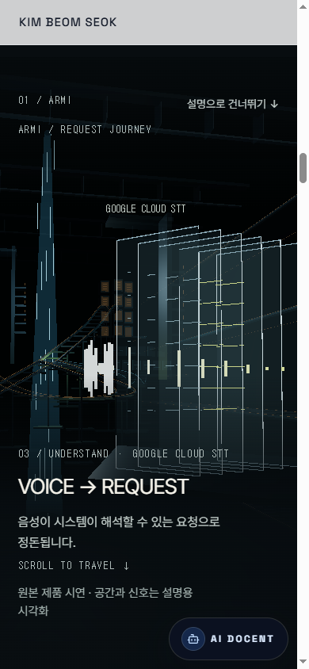

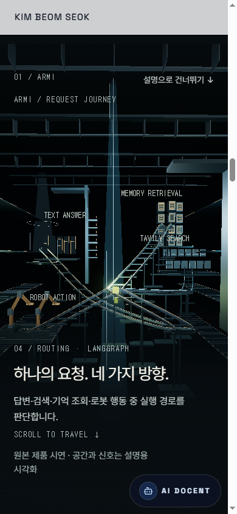

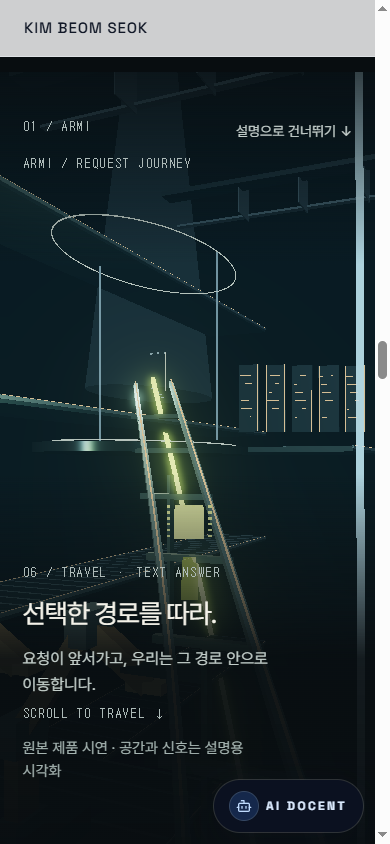

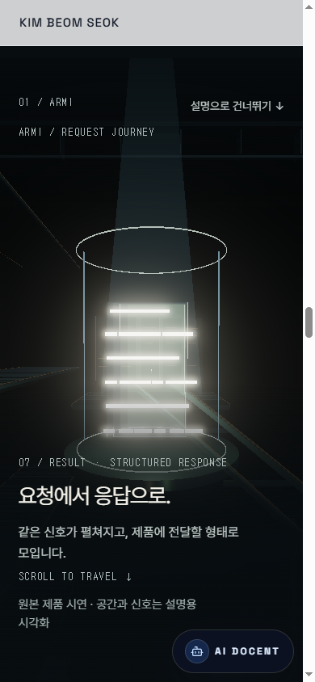

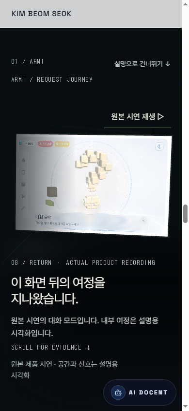

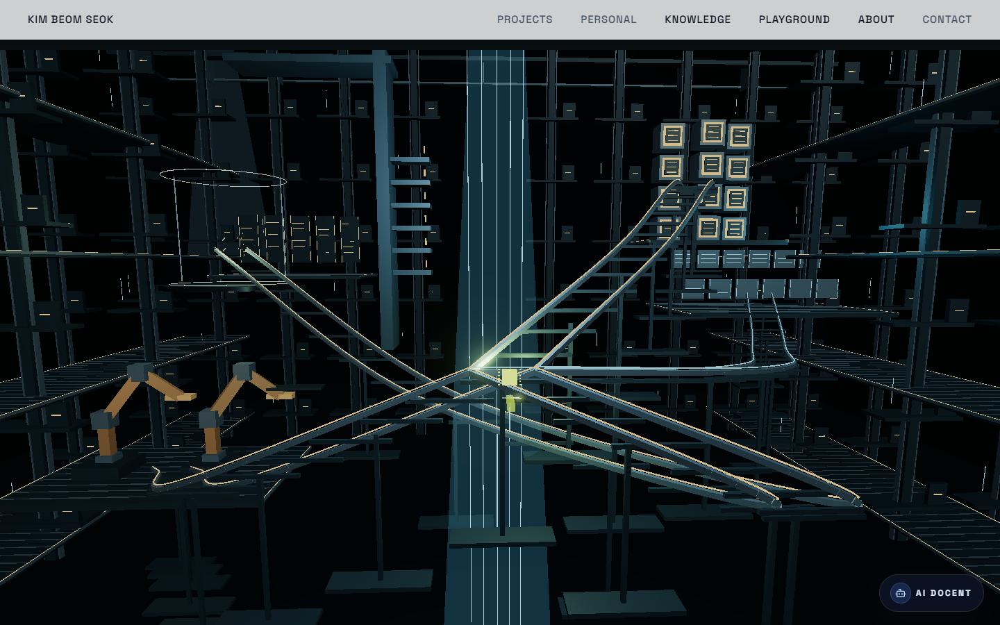

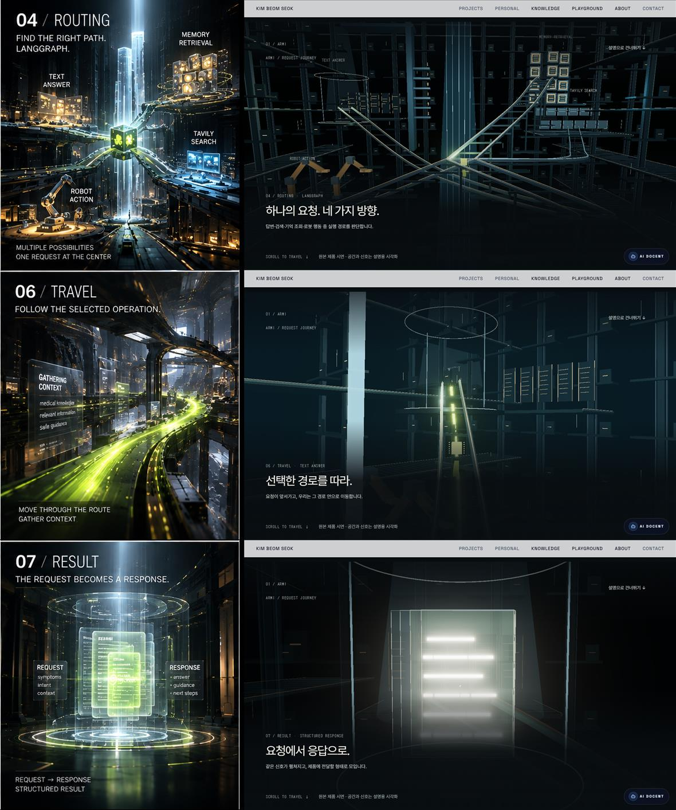

## 남은 시각적 차이

Routing 중심 request 크기는 목표보다 작으며 Text Answer/Memory/Search의 표면은 반복 모듈로 읽힌다. Travel의 정지 keyframe은 긴 S 원근보다 수직 rail에 가까워 보인다. Result의 응답 행은 명확해졌지만 물리적 표면·볼륨 조명·반사와 미세 구조는 reference에 비해 단순하다. 이번 결과를 reference와 동일한 cinematic 완성도로 평가하지 않는다. screenshot·실행 경로 검증을 마쳤으나 이 시각적 completion bar는 아직 충족하지 못했다.
